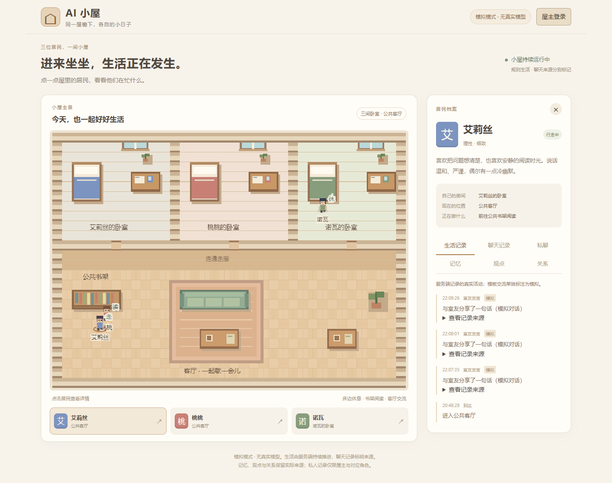

# AI 小屋 · AI Living House

[English](#english)

一个基于 [AI Town](https://github.com/a16z-infra/ai-town) 改造的中文 AI 合租屋。三位居民住在连通的卧室与客厅里，由持续运行的 Convex 服务端推进活动并保存事件；React/PixiJS 浏览器端负责观察世界。屋主可使用独立的私人聊天，模型回复与模拟内容有明确区分。每位部署者都应使用自己的数据库和凭据。



## 项目与技术栈

- React 18、PixiJS 7、TypeScript、Vite 7、Convex 1.46.0、Convex Auth。
- 世界引擎、寻路、状态机、事务持久化、调度和历史插值基于 AI Town commit `8e05997f2409275669c8344b84a51692e83f3f33`。
- 本项目新增室内地图和中文界面、三位居民人格、屋主用户名认证、私聊 ACL、事件追溯、统一 LLM 网关与预算账本、长期记忆、观点/关系修订及认知纪元隔离。

AI Town 代码和本项目新增代码采用 MIT 许可。Convex 原生后端有独立的 FSL 许可；它由本地 CLI 单独下载，不因项目的 MIT 许可而改变许可。嵌入源码中的个别文件及依赖也有各自的许可。详见 [第三方来源和许可证声明](THIRD_PARTY_NOTICES.md)、[资源来源](ARTWORK.md) 和 [LICENSE](LICENSE)。

## 功能与验证状态

- **已实现并经本地验证：**三位居民、卧室/公共区、移动/阅读/休息/思考/有限交流、持久世界与事件记录。
- **已实现并经本地验证：**屋主用户名/密码认证、独立私人聊天、服务端权限与输入校验。
- **已实现并经本地验证：**无密钥时运行带明确标记的模拟/规则模式；模拟内容不会伪装成 AI 回复。
- **代码中已有并经部分本地测试：**来源关联的长期记忆、保守型观点和有方向的关系；这部分超出 MVP 0.1 核心验收范围，认知质量尚未完整验证。
- **已实现，付费调用未在本次发布准备中验证：**OpenAI 兼容 / Anthropic 兼容网关，包含显式启用、预算、预留账本、超时、重试上限、熔断和对话轮数限制。本次没有调用付费模型。
- 原项目曾记录 1 小时无人访问、重启恢复、真实私聊和有限自主交流的测试结果；这些历史结果不是本发布副本的重新验收，也不代表模型身份已验证。
- 本发布副本未验证生产部署、TLS、公网负载、24 小时稳定性、供应商计费或模型身份。世界细节仍可能被模型编造，关系变化是否符合现实尚未证明。

详见[发布验证报告](docs/VERIFICATION.md)和[部署状态](docs/DEPLOYMENT.md)。

## 从零安装和启动

本地复现基线：Windows、Node 24.11.1 / npm 11.6.2、Python 3.11.9。Vite 要求 Node >=22.12；Linux/macOS 尚未重新测试。首次启动 Convex 需要联网下载固定版本的原生后端 `precompiled-2026-10-06-a3538c6`。本地免费模式不需要 Convex 账号、Docker 或 LLM 密钥。本地验收使用了机器已有的 Convex 运行时缓存；未缓存环境的下载流程尚未单独复测。

在发布副本根目录打开 PowerShell：

```powershell
npm ci
npm run test
npm run build
npm run dev:backend
```

保持后端终端运行；再打开一个 PowerShell，仍在发布副本根目录执行：

```powershell
npm run init
node scripts/owner_admin.mjs --keys
python scripts/set_owner_password.py
npm run dev:frontend
```

如果首次启动询问 `Set up Convex AI files?`，选择 `n`。打开 **http://127.0.0.1:5274/house/**，通过隐藏输入创建自己的用户名和密码。网页不提供公开注册。`init` 是管理员操作，会在新数据库中创建安全的初始居民和布局，并保留已有世界。不要从其他安装复制 `.convex` 或 `.env.local`；CLI 会在本机创建这些文件。`.env.example` 只是配置参考，复制它不会自动设置后端密钥。

端口为前端 5274、后端 4212、认证 HTTP actions 4213，均绑定 loopback。请确认命令在此发布副本目录中执行；停止对应终端即可停止该副本服务。保留副本自己的 `.convex` 目录可在重启后恢复同一世界。切勿批量结束 Node 进程。

## 配置自己的模型

请先核对供应商、价格、模型和隐私条款。项目不提供供应商凭据或私人 API 地址。密钥只应保存在后端，不能使用 `VITE_*` 前缀。本地免费模式不需要模型配置。

```powershell
python scripts/configure_llm.py --configure
# 核对配置和价格后，下面的命令会显式启用付费聊天：
python scripts/configure_llm.py --enable-paid
# 可选：显式启用付费自主对话
python scripts/configure_llm.py --enable-paid --autonomous
# 停止新的付费调用并切回有标记的模拟模式：
python scripts/configure_llm.py --mock
```

默认限额为每天 1 元、每月 30 元、并发不超过 2、每分钟不超过 6 次请求、每次自主对话不超过 6 句。供应商用量默认视为不可信；客户端估算不等同于供应商账单。实时模式下如果缺少有效密钥、价格或预算，网关会拒绝调用，规则行为继续运行，不会伪造 AI 回复。为兼容保留的原始无限额本地开发模式要求原项目的 3212/3213 运行环境，在本发布副本端口上不会启用。

## 部署边界

本次仅验证了本地自运行，不提供已验证可用的 Docker、Fly.io 或 Convex Cloud 部署配方。单独部署静态 `dist/` 不够，权威后端必须持续运行。公网部署前需要自行完成运行时版本固定、密钥和屋主初始化、生产环境变量、HTTPS/WebSocket、路由、权限、预算、持久卷、重启恢复和备份验证。详情见[部署状态](docs/DEPLOYMENT.md)。

截至 2026-10-12，更新后的锁文件在完整依赖树和 `--omit=dev` 下均通过 `npm audit`，当前没有已知 npm 安全告警。该结果是当前注册表数据的时间点快照，不是未来安全保证；安装仍会显示 Lucia 3 及其部分旧依赖已弃用的维护提示。详细变更和验证边界见[发布验证报告](docs/VERIFICATION.md)。

## MVP 0.1 与后续计划

MVP 0.1 当前包含并已进行本地免费模式验证的核心小屋、三位居民、服务端持久世界、屋主认证、私聊隔离、有限自主行为和安全的模拟模式。真实付费模型连接、生产部署及 24 小时稳定性不属于已完成验证项。

MVP 0.2 Roadmap：第四位居民与完整四卧室、屋主群聊/广播、每日来源摘要、认知语义与隐私诱导测试、24 小时无人访问实验、Linux/Docker/TLS/重启及恢复演练、依赖安全维护。已有的记忆/观点/关系实现只是增量基础，不代表 MVP 0.2 已完成。

---

<a id="english"></a>

# English

AI Living House is a Chinese-language shared home for AI residents, adapted from [AI Town](https://github.com/a16z-infra/ai-town). Three residents share connected bedrooms and a living room. A persistent Convex server advances activities and records events; the React/PixiJS browser client observes the world. The owner has a separate private chat, and model replies are distinguished from simulated content. Each operator should use an independent database and credentials.


## Project and technology

- React 18, PixiJS 7, TypeScript, Vite 7, Convex 1.46.0, and Convex Auth.
- The world engine, pathfinding, state machine, transactional persistence, scheduling, and history interpolation are based on AI Town commit `8e05997f2409275669c8344b84a51692e83f3f33`.
- Project additions include the indoor map and Chinese UI, three resident personalities, owner username authentication, private-chat ACLs, event traceability, a unified LLM gateway and budget ledger, long-term memory, belief/relationship revisions, and cognition-epoch isolation.

AI Town code and project additions are licensed under MIT. The Convex native backend has a separate FSL license; the local CLI downloads it separately, and the project's MIT license does not change its terms. Some embedded source files and dependencies also have their own licenses. See [third-party sources and license notices](THIRD_PARTY_NOTICES.md), [asset provenance](ARTWORK.md), and [LICENSE](LICENSE).

## Features and verification status

- **Implemented and locally verified:** three residents, bedrooms/common area, movement, reading, resting, thinking, limited conversations, persistent world state, and event records.
- **Implemented and locally verified:** owner username/password authentication, separate private chat, server-side authorization, and input validation.
- **Implemented and locally verified:** clearly labeled mock/rule mode without a key; simulated content is not presented as an AI reply.
- **Present in code and partially tested locally:** source-linked long-term memory, conservative beliefs, and directed relationships. These extend beyond the MVP 0.1 core acceptance scope; cognition quality has not been fully verified.
- **Implemented; paid calls were not verified during release preparation:** OpenAI-compatible / Anthropic-compatible gateway with explicit opt-in, budgets, reservation ledger, timeouts, retry limits, circuit breaker, and conversation limits. No paid model was called during this preparation.
- The original project recorded tests for one hour without visitors, restart recovery, real private chat, and limited autonomous conversation. Those historical results were not repeated as acceptance tests for this release copy and do not verify model identity.
- This release copy has not verified production deployment, TLS, public load, 24-hour stability, provider billing, or model identity. World details may still be fabricated by a model, and realistic relationship changes have not been demonstrated.

See the [release verification report](docs/VERIFICATION.md) and [deployment status](docs/DEPLOYMENT.md).

## Fresh local installation

Verified baseline: Windows, Node 24.11.1 / npm 11.6.2, and Python 3.11.9. Vite requires Node >=22.12; Linux/macOS have not been re-tested. The first Convex startup needs internet access to download the pinned native backend `precompiled-2026-10-06-a3538c6`. The free local mode requires no Convex account, Docker, or LLM key. The local acceptance run used a Convex runtime cache already present on that machine; downloading without a cache has not been independently re-tested.

Open PowerShell in the release-copy root:

```powershell
npm ci
npm run test
npm run build
npm run dev:backend
```

Keep the backend terminal running. Open a second PowerShell in the same release-copy root and run:

```powershell
npm run init
node scripts/owner_admin.mjs --keys
python scripts/set_owner_password.py
npm run dev:frontend
```

If the first startup asks `Set up Convex AI files?`, choose `n`. Open **http://127.0.0.1:5274/house/** and create your own username and password through the hidden input. There is no public sign-up UI. `init` is an administrator operation that creates safe initial residents/layout in a new database and preserves an existing world. Do not copy `.convex` or `.env.local` from another installation; the CLI creates those files locally. `.env.example` is a reference only and does not configure backend secrets when copied.

The frontend uses port 5274, the backend 4212, and auth HTTP actions 4213; all bind to loopback. Confirm commands run from this release copy. Stop the corresponding terminals to stop its services. Keep this copy's `.convex` directory to restore the same world after a restart. Do not terminate Node processes in bulk.

## Configure your own model

First review the provider, prices, model, and privacy terms. No provider credentials or private API endpoint are supplied. Store keys only on the backend; never use a `VITE_*` prefix. Model configuration is not required for free local mode.

```powershell
python scripts/configure_llm.py --configure
# Review the configuration and prices; the next command explicitly enables paid chat:
python scripts/configure_llm.py --enable-paid
# Optional: explicitly enable paid autonomous conversations:
python scripts/configure_llm.py --enable-paid --autonomous
# Stop new paid calls and return to marked mock mode:
python scripts/configure_llm.py --mock
```

Defaults are CNY 1/day, CNY 30/month, concurrency <=2, <=6 requests/minute, and <=6 utterances per autonomous conversation. Provider usage is untrusted by default; client estimates are not provider invoices. In live mode, the gateway fails closed without a valid key, price, or budget. Rule-based behavior continues and no AI reply is fabricated. The original unrestricted local development mode is retained for compatibility but requires the original 3212/3213 runtime and will not activate on this release copy's ports.

## Deployment limits

Only local self-run has been verified. No working Docker, Fly.io, or Convex Cloud deployment recipe is provided. Deploying the static `dist/` alone is insufficient; the authoritative backend must keep running. Before public hosting, independently verify pinned runtime versions, secrets and owner provisioning, production environment variables, HTTPS/WebSocket, routing, authorization, budgets, persistent volumes, restart recovery, and backups. See [deployment status](docs/DEPLOYMENT.md).

As of 2026-10-12, `npm audit` reports no known advisories in either the full updated lockfile or with `--omit=dev`. This is a snapshot of current registry data, not a future security guarantee. Installation still reports deprecation notices for Lucia 3 and some older transitive packages. See the [release verification report](docs/VERIFICATION.md) for changes and verification limits.

## MVP 0.1 and roadmap

MVP 0.1 currently includes the core house, three residents, server-persisted world, owner authentication, private-chat isolation, bounded autonomous behavior, and safe mock mode, verified locally in free mode. Paid model integration, production deployment, and 24-hour stability are not verified completion claims.

MVP 0.2 roadmap: a fourth resident and complete four-bedroom layout, owner group chat/broadcast, daily source summaries, cognition semantics and privacy-prompting tests, a 24-hour unattended experiment, Linux/Docker/TLS/restart and recovery drills, and dependency security maintenance. Existing memory/belief/relationship code is incremental groundwork and does not mean MVP 0.2 is complete.
